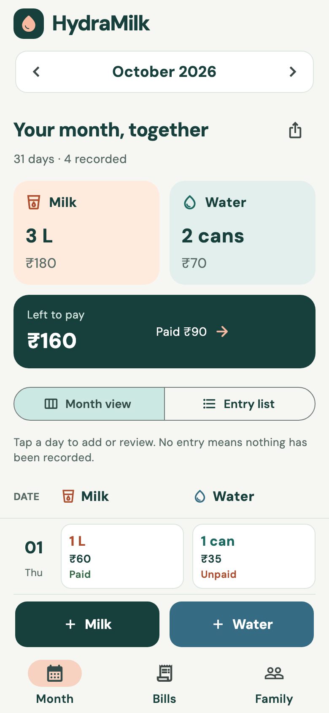
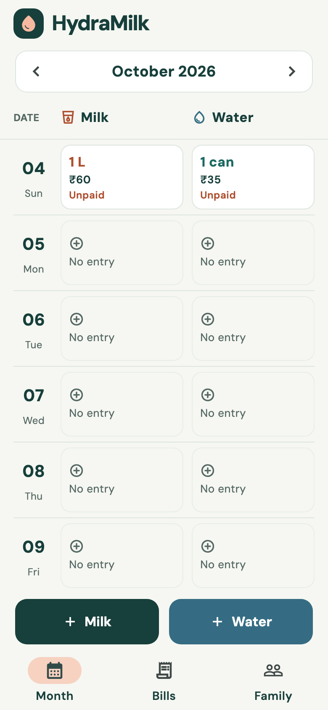
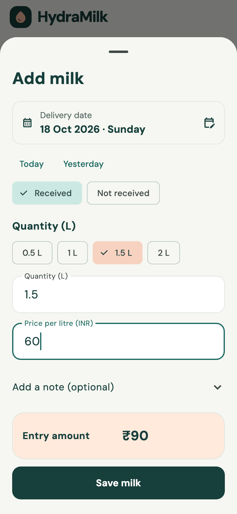

# HydraMilk 3.0

HydraMilk is a Flutter Android app for milk and water bills, redesigned around three screens: **Month, Bills, Family**. The new teal-and-peach interface opens a complete day-by-day month register with milk and water side by side. The launcher name, app header, icon, and exported statements now use HydraMilk. The existing Android application ID and sign-in callback are retained so this APK can update the previous installation and keep its data.

## Download and setup

[Download the Android APK](https://github.com/hardikdhingra150/HydroMilk/releases/tag/v3.0.0) · [Quick start](docs/QUICK_START.md) · [Configuration](docs/CONFIGURATION.md) · [Authentication](docs/AUTHENTICATION.md)

The GitHub repository is named **HydroMilk**; the installed app is branded **HydraMilk**. The source includes the Flutter app, Android project, bundled fonts and licenses, PostgreSQL migrations, and automated tests. Build outputs and private credentials are excluded.

<table><tr>
<td></td>
<td></td>
<td></td>
</tr></table>

Screenshots use test fixtures to demonstrate the interface. Fresh installations start empty.

## Daily use

- **Month:** choose a month/year. Every date appears, with separate Milk and Water cells showing recorded quantities, charges, and payment status. Empty dates say **No entry**, which is different from **Not received** and adds no assumed charge. The date/service header stays visible as you scroll. Daily cells combine multiple deliveries; tap a cell to see every individual entry and note. Tap a date to review both services. **Month view / Entry list** switches between the full register and detailed entries with All/Unpaid/Paid filters. Use the fixed **+ Milk** or **+ Water** button for a new entry, or add directly from a day cell to preselect that date. The entry form begins with a labeled full delivery date, calendar/manual date entry, and Today/Yesterday shortcuts. Dates display as `19 Oct 2026`; manual date input uses **DD/MM/YYYY**. Choose quantity or type a custom amount, enter the price, and save. Not received days have no charge. Tap an entry to correct its date, quantity, price, or note, or delete it.
- **Bills:** each supplier is labeled **Unpaid**, **Part paid**, **Paid**, **Credit**, or **No bill yet**. **Mark paid** offers the exact remaining amount; change it for a partial payment. Every payment records its own payment date and explicitly identifies its billing month. Payment history lets you remove an incorrect record. No money is transferred by this app.
- **Family:** see account, connection status, invite code, members, and last refresh time. Copy/share a code with other family members. Default prices are optional. Export, owner invite rotation, member removal/departure, sign-out, and local recovery controls are available here.

A fresh installation has no sample entries, payments, prices, or budget. New cloud families also start empty. Preset quantities are choices, not recorded deliveries. Real existing local/cloud records and payments are preserved on update. The older sample-ledger archive can be restored from Family → More options while the local ledger is empty; restoration includes any old sample records.

## How paid/unpaid works

Payments are recorded for a specific **supplier and billing month**. They are allocated to received deliveries in ascending date order, with entry ID as a stable tie-breaker. Each entry displays **Unpaid**, **Part paid**, or **Paid** from this allocation. Skipped and zero-charge entries are not unpaid debts. An entry's paid amount is never more than its charge; extra payment is shown as monthly supplier credit.

This is derived from actual payments rather than a separate boolean flag, so correcting/deleting an entry or payment updates its status consistently. Credits remain within their billing month; they are not automatically carried to another month. Backdating a delivery can change which entry is paid first. The Bills screen explains the allocation rule.

Quantities are thousandths of a litre/can, prices/payments are minor currency units. A delivery costs `(quantity_milli × rate_paise + 500) ~/ 1000`; skipped days cost zero. PostgreSQL calculates the same generated amount. Earlier entries retain their own price when a default changes. Existing INR/USD/EUR/GBP configuration is preserved; currency labels do not convert amounts. A water can means the supplier's usual container size.

## Family sharing and recovery

1. The first person signs in with Google/email and chooses **Create a family**.
2. Open **Family → Copy code** or **Share code**.
3. Everyone else signs in on their own phone, chooses **Join a family**, and enters that code and their own name.

One account belongs to one family. Family members share editing access. Owners can replace invite codes and remove members; members can leave. Anyone with the private invite code can join, so share it only with your family. Existing members retain access when a code is replaced. Removed members lose access when they reload; the app refreshes automatically while active every 20 seconds, on resume, and after writes. The refresh icon and pull-to-refresh are also available. Month summaries show milk litres, water cans, individual supplier charges, the amount paid, and the remaining balance for the selected month. Monthly CSV exports now include the complete daily register, including missing dates, followed by individual records, payment history, and totals.

Cloud operations require an internet connection. A write followed by a failed reload keeps the successful write locally visible and offers recovery. If family creation/joining succeeds but reloading fails, the app opens a Retry screen rather than prompting a duplicate create/join. Sign-out invalidates outstanding reads so a late response cannot restore shared data. Invalid-code and form errors appear directly inside their form. There is no offline write queue or server push subscription.

The private local ledger stays separate from the cloud ledger. Signing in does not silently upload it. Signing out returns to welcome; Use without an account opens that phone's local records. Uninstalling or clearing app data may remove local records, so export important statements first. The app does not implement account deletion, owner transfer, or whole-family deletion.

## Live backend

Supabase project `dailydrop` / `cfzbckhlwztbqwswzpzq` is already configured. Google and email sign-in are enabled. The app uses PKCE and an external browser. Google Web callback:

```text
https://cfzbckhlwztbqwswzpzq.supabase.co/auth/v1/callback
```

The allowlisted Android callback is unchanged:

```text
com.familyledger.peachledger://login-callback
```

Email signup now requests that mobile callback as well. The Google consent-screen display name was updated to HydraMilk and saved in Google Cloud; the underlying Cloud project is still DailyDrop (`dailydrop-512018`). Google secrets stay in Supabase; `config.dailydrop.json` contains only the project URL and public publishable key. Do not include database passwords or service-role/Google secrets in the app.

All four public tables have RLS enabled. Privileged implementations remain private, with authenticated invoker wrappers. Existing-owner read access and outsider denial for families/members/deliveries/payments were verified live in rolled-back read transactions without altering records. No database schema/data migration was required for this UI release.

The current security advisor reports one Auth recommendation: leaked-password protection is disabled. See [Supabase password protection](https://supabase.com/docs/guides/auth/password-security#password-strength-and-leaked-password-protection). No access policy was weakened for the redesign.

## Build

Requires Flutter 3.41+ / Dart 3.11+, Java 17+ (built with Java 21), and Android SDK tools. This APK supports Android API 24+.

```sh
flutter pub get
flutter analyze
flutter test
flutter build apk --release --dart-define-from-file=config.dailydrop.json
```

Release output: `build/app/outputs/flutter-apk/app-release.apk`. The delivered `HydraMilk-v3.0.apk` is a universal development-signed release APK for direct personal installation, not a Play Store publication. Its package is `com.familyledger.peach_ledger`, version **3.0.0+5**. A public store release needs a private upload keystore and app bundle.

For a separate Supabase project, apply the existing four SQL migrations once in filename order, enable providers, configure callbacks, and create a public client config from `config.example.json`. Do not rerun the initial migrations against the existing live project.

## Verification

Static analysis: no issues. **25 automated tests passed**, covering empty first launch, dated entries including typed leap-day dates, amount validation, fractions/rounding, historical months/years, paid/partial/unpaid allocation, credit, payment retries/removal, Google PKCE/browser launch/cancellation, and small/large layouts at 320/390/1200 pixels with text up to 140%. Added tests cover 28/29/30/31-day months, leap years, distinct unrecorded/skipped states, mixed and multiple deliveries, aggregate payment status, editing from a day cell, adding to a chosen date, and scrolling to the last date of a month.

Family tests exercise the real Dart Auth/PostgREST client against an in-memory HTTP server: two accounts create/join the same family, share entries/payments, rotate invite codes, remove/rejoin/leave, recover failed reloads, and sign out without stale reads leaking back. Widget tests also operate the actual create/join forms and verify visible invalid-code errors. These are automated integration tests, not a claim of a completed two-physical-phone Google login.

PostgreSQL tests passed on a disposable PostgreSQL 16 database for family creation/join, owner permissions, revocation, RLS isolation, skipped charges, idempotent payment retries, and invalid data. Never run the Auth fixture against a real project.

```sh
psql "$TEST_DATABASE_URL" -v ON_ERROR_STOP=1 \
  -f supabase/tests/fixture.sql \
  -f supabase/migrations/202610130001_ledger.sql \
  -f supabase/migrations/202610130002_family_controls.sql \
  -f supabase/migrations/20261018184049_private_rpc_boundaries.sql \
  -f supabase/migrations/20261018222823_empty_family_defaults.sql \
  -f supabase/tests/isolation.sql
```

Optional preview capture: `HYDRAMILK_PREVIEWS=1 flutter test test/app_test.dart`. Preview records and example accounts are test fixtures and are not bundled as runtime data. Real Google/email delivery, installation, and cross-device operation on physical phones remain unverified.

Source: `lib/main.dart` (interface/auth), `lib/store.dart` (local/cloud state and payment allocation), `lib/models.dart` (accounting), `test/` (behavior/integration tests), `supabase/` (schema/security tests), `assets/` (theme image/fonts/licenses).

References: [Flutter Android builds](https://docs.flutter.dev/deployment/android), [Supabase Flutter](https://supabase.com/docs/guides/getting-started/quickstarts/flutter), [Google sign-in](https://supabase.com/docs/guides/auth/social-login/auth-google), [Email redirects](https://supabase.com/docs/reference/dart/auth-signup), [Auth state changes](https://supabase.com/docs/reference/dart/auth-onauthstatechange).
